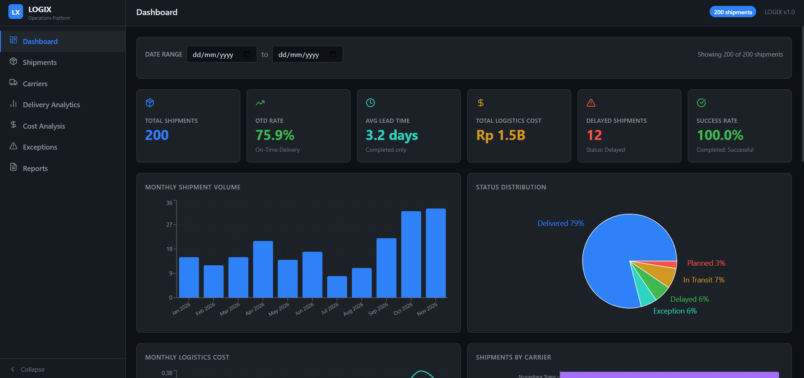
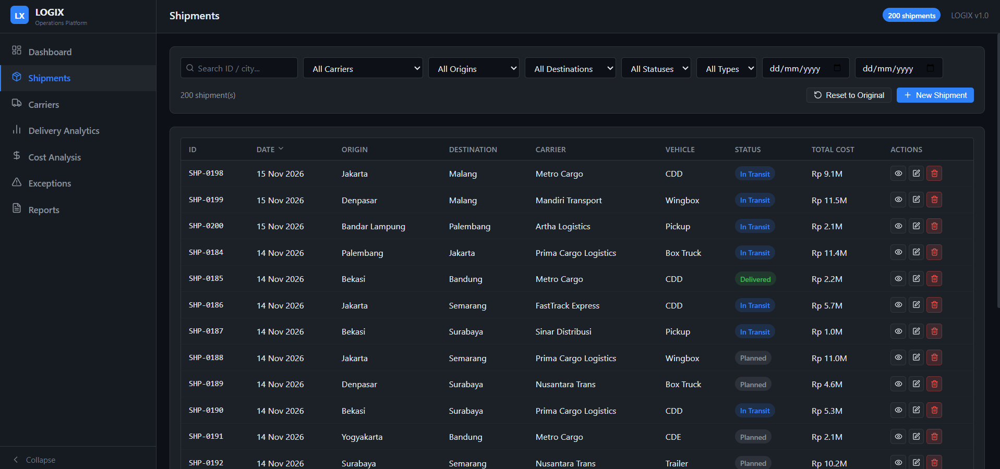
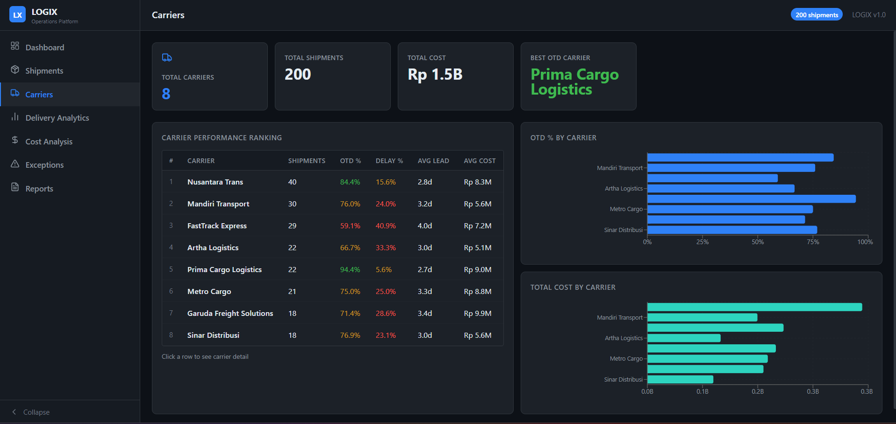
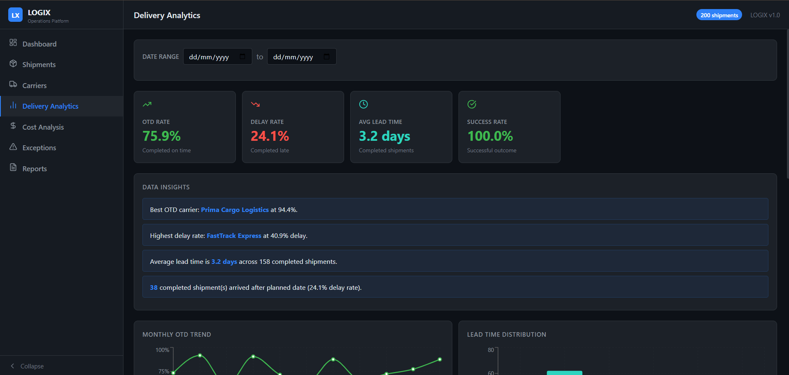
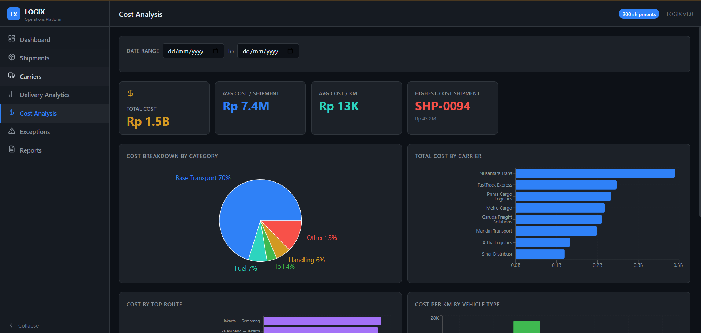
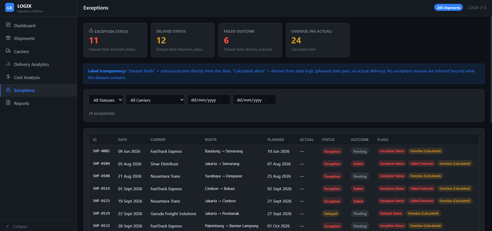
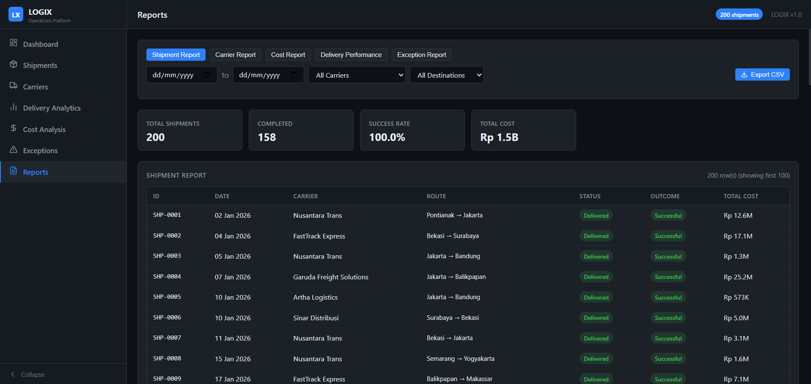

# LOGIX — Logistics Operations & Performance Management System

LOGIX is a web application for monitoring logistics operations, evaluating carrier and delivery performance, and analyzing transportation costs. It is built around a simulated shipment dataset of a fictional Indonesian logistics company and is designed for logistics managers, transportation managers, supply chain analysts, and operations teams.

**Live demo:** https://logix-app.vercel.app/


## Screenshots

### Executive Dashboard
KPI cards, monthly shipment volume, status distribution, and a date range filter.



### Shipment Management
Search, filters, sortable table, and actions to view, edit, and delete shipments, plus a Reset to Original option.



### Carrier Management
Carrier performance table (shipments, OTD, delay rate, average lead time, average cost) with OTD and cost comparison charts.



### Delivery Analytics
OTD, delay rate, lead time, and success rate, with insights calculated from the dataset.



### Cost Analysis
Total cost, average cost per shipment and per kilometer, highest-cost shipment, and cost breakdowns.



### Exception Management
Dataset fields (Exception and Delayed status, Failed outcome) clearly separated from calculated alerts (overdue with no actual delivery).



### Reports
Five report types with filters, summary metrics, and CSV export.



## Features

| Module | What it does |
|---|---|
| **Executive Dashboard** | KPI cards (total shipments, OTD rate, average lead time, total cost, delayed shipments, success rate), monthly volume and cost trends, status distribution, carrier comparison, top routes, recent shipments, operational alerts. |
| **Shipment Management** | Searchable, filterable, sortable, paginated shipment table with detail view and full CRUD (create, edit, update status, delete with confirmation) plus input validation. |
| **Carrier Management** | Per-carrier metrics (shipments, OTD, delay rate, lead time, total and average cost), ranking, comparison charts, and carrier detail view. |
| **Delivery Analytics** | OTD trend, planned vs actual delivery, performance by carrier and destination, delay distribution, and insights computed from the data. |
| **Cost Analysis** | Cost breakdown by category, carrier, route, and vehicle type; cost per kilometer; highest-cost shipment; and a what-if cost scenario simulator (clearly labeled as simulated). |
| **Exception Management** | Operational cases derived from existing fields: Exception and Delayed statuses, overdue shipments with no actual delivery date, and failed deliveries. |
| **Reports & Insights** | Five report types with date, carrier, and destination filters, summary metrics, data tables, and CSV export of filtered records. |

## Tech Stack

- React + Vite
- Recharts (charts)
- Lucide (icons)
- CSS
- Deployed on Vercel

<!-- Verify this list against package.json and adjust if your project differs. -->

## Dataset

The app uses `logix_shipments.csv` as its data source: 200 shipment records and 19 columns covering January–November 2026 across 15 Indonesian cities, 8 fictional carriers, and 7 vehicle types. Costs are in Indonesian Rupiah (IDR). The data is synthetic and was generated for this project with a fixed random seed.

Columns: `shipment_id`, `shipment_date`, `origin_city`, `destination_city`, `carrier_name`, `vehicle_type`, `shipment_type`, `cargo_weight_kg`, `distance_km`, `planned_delivery_date`, `actual_delivery_date`, `shipment_status`, `delivery_outcome`, `base_transportation_cost`, `fuel_cost`, `toll_cost`, `handling_cost`, `other_cost`, `total_logistics_cost`.

## KPI Definitions

All KPIs are calculated dynamically from the data through one shared calculation layer, so every module uses the same logic. A shipment is **completed** when it has an `actual_delivery_date`.

| KPI | Definition |
|---|---|
| Total Shipments | Count of unique `shipment_id` |
| On-Time Delivery (OTD) Rate | Completed shipments delivered on or before the planned date ÷ completed shipments × 100 |
| Delay Rate | Completed shipments delivered after the planned date ÷ completed shipments × 100 |
| Average Lead Time | Average days from `shipment_date` to `actual_delivery_date` (completed only) |
| Delivery Success Rate | Completed shipments with outcome `Successful` ÷ completed shipments × 100 |
| Total Logistics Cost | Sum of `total_logistics_cost` |
| Average Cost per Shipment | Total logistics cost ÷ shipment count |
| Average Cost per Kilometer | Total logistics cost ÷ sum of `distance_km` |

Shipments without an actual delivery date are excluded from completed-delivery KPIs, and a `Delayed` status is not automatically counted as a late completed delivery.

## Data Persistence

The original CSV is loaded as the initial data and is never modified. Changes made through Shipment Management (create, edit, status update, delete) are stored separately in the browser's localStorage and restored after a refresh. A **Reset to original data** option restores the dataset to its original state. Because storage is local, changes are specific to one browser and are not shared between users.

## Getting Started

```bash
# install dependencies
npm install

# run the development server
npm run dev

# build for production
npm run build

# preview the production build
npm run preview
```

## Project Structure

```
src/
  components/    reusable UI components
  layouts/       main layout, sidebar, top bar
  pages/         Dashboard, Shipments, Carriers, DeliveryAnalytics,
                 CostAnalysis, Exceptions, Reports
  services/      CSV loading and data processing
  utils/         KPI calculations, formatters
  hooks/         shared React hooks
  styles/        global styles and design tokens
```

<!-- Adjust to match your actual folder layout. -->

## Limitations

- The dataset is simulated, so results illustrate how the system works and do not reflect real operations.
- The dataset has no exception reason or category columns, so Exception Management only uses existing status, outcome, and date fields and distinguishes dataset fields from calculated alerts.
- There is no backend or database; data changes live in localStorage only.
- The cost simulator produces what-if estimates, not forecasts based on a trained model.

## Future Development

- Backend and database with authentication and user roles
- Richer data (delay causes, exception categories, carrier contract rates)
- Integration with TMS/ERP systems and carrier tracking APIs, plus map/GPS views
- Predictive features (delay and cost prediction, carrier recommendation) and a natural-language assistant
- Unit tests for KPI functions and PDF/Excel report export
